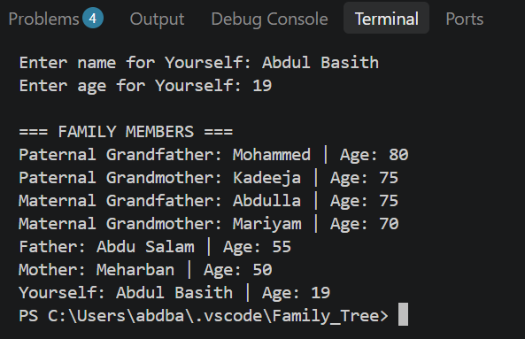

# Family Tree Project in C

## Project Description
This project is a Family Tree program written in C.
It collects the names and ages of seven family
members across three generations.

The program uses structures and pointers to
connect family members and display their
relationships.

## Features
- Takes input for 7 family members
- Stores names and ages using structures
- Connects parents and grandparents using pointers
- Displays family relationships
- Uses malloc() and free() for memory management

## How to Run

Compile the program:

gcc family_tree.c -o family_tree.exe

Run the program:

./family_tree.exe

## Program Output

## Author
Abdul Basith K T
